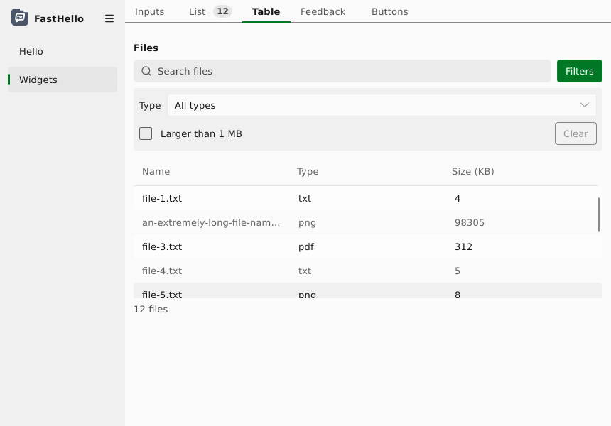

# FastHello

[](https://github.com/evandro777/FastHello/actions/workflows/ci.yml)
[](https://github.com/evandro777/FastHello/actions/workflows/flatpak.yml)
[](https://github.com/evandro777/FastHello/actions/workflows/appimage.yml)
[](https://github.com/evandro777/FastHello/actions/workflows/virustotal.yml)
[](https://github.com/evandro777/FastHello/releases/latest)
[](https://www.linux.org/)
[](https://opensource.org/licenses/GPL-3.0)

The starter kit and widget sandbox of the Fast apps: light and fast Linux apps built with Rust + [Slint](https://slint.dev) (software renderer, no GL). It is a working app on its own, and the base every other Fast app starts from.

Page: <https://evandro777.github.io/FastHello/>

<picture>
  <source media="(prefers-color-scheme: dark)" srcset="docs/screenshots/widgets-table-dark.png">
  
</picture>

## Features

- What you can try:
    - Type your name and the greeting updates as you type.
    - A sidebar switches between Hello and Widgets. Its burger button opens the preferences dialog (Appearance and Language). Its About button opens a dialog with the icon, version, description and website link.
    - The Widgets page has five tabs (Ctrl+Tab and Ctrl+Shift+Tab step through them, and wrap around):
        - Inputs: checkbox, slider, spin box, switch, radio buttons, password field and text area, some of them linked to each other.
        - List: an add/remove list.
        - Table: a sortable table with a search box and a Filters button (file type, larger than 1 MB). Typing anywhere on this tab goes into the search box, no need to click it first. Esc empties the search box.
        - Feedback: a progress bar and spinner for a running task.
        - Buttons: text, icon and step buttons, and a delete that asks for confirmation first.
    - The preferences dialog has an Appearance choice (System, Light or Dark) and a Language choice (System, English or Português), both remembered.
- What every Fast app gets from it:
    - One window: a second start raises the running one.
    - Settings written safely (private files, atomic writes, a damaged file is kept as a backup).
    - Preferences and About dialogs, light/dark and language switching, and shared controls that look the same in every app.
    - Flatpak with its own signed auto-update remote, an AppImage with delta updates, and CI.

## Install

### Flatpak

#### Install from file (no updates)

A `.flatpak` file downloaded from Releases is a one-off install (will not auto update). To get automatic updates, go to [Install with automatic updates](<#Install with automatic updates>).

Download `FastHello-<version>-x86_64.flatpak` from [Releases](https://github.com/evandro777/FastHello/releases), then execute:

```bash
flatpak install --user ~/Downloads/FastHello-<version>-x86_64.flatpak
```

#### Install with automatic updates

This app is not in Flathub yet. You need to add this repository as a remote. Every release is also published as a Flatpak remote, so `flatpak update` (or your software centre) keeps the app updated.

```bash
flatpak remote-add --system --if-not-exists fasthello https://evandro777.github.io/FastHello/fasthello.flatpakrepo
flatpak install --system fasthello io.github.evandro777.FastHello
```

**`--system` vs `--user` matters for updates.** Linux Mint's Update Manager (and probably other software centres) only looks at *system-wide* Flatpaks; With `--user`, update by hand: `flatpak update --user`.

The remote is GPG-signed (system-wide installs refuse unsigned remotes), but the key lives in this same repository. It needs the Flathub remote for the runtime (`flatpak remote-add --if-not-exists flathub https://dl.flathub.org/repo/flathub.flatpakrepo`, with `--system` or `--user` to match).

### AppImage (with delta updates)

Download `FastHello-<version>-x86_64.AppImage` from [Releases](https://github.com/evandro777/FastHello/releases), then execute:

```bash
sudo chmod +x ~/Downloads/FastHello-<version>-x86_64.AppImage
~/Downloads/FastHello-<version>-x86_64.AppImage
```

It uses the fontconfig, xkbcommon and X11 libraries already on your system.

The AppImage does not update itself, but it has update information built in, so a tool such as [AppImageUpdate](https://github.com/AppImageCommunity/AppImageUpdate) (`appimageupdatetool FastHello-*.AppImage`), [Gear Lever](https://github.com/mijorus/gearlever) or [AppManager](https://github.com/kem-a/AppManager) downloads only the changed parts of the next release.

<!-- template:start -->
## Start your own app

1. Copy this repository and run `./prepare.sh <crate> <DisplayName> <github-owner>`. It renames everything, resets the version to 0.1.0 and does the first build.
2. Replace the example pages, the icon (`docs/ICON-STYLE.md`) and the text marked `EDIT` in `docs/site/index.html`, the metainfo and `AGENTS.md`.
3. Run `flatpak/new-signing-key.sh`, do the one-time setup in [`RELEASING.md`](RELEASING.md), then tag `v0.1.0`.
<!-- template:end -->

## Other Fast apps

Built from this template, with the same look and the same light, fast approach:

- [FastApiClient](https://github.com/evandro777/FastApiClient): REST API client.
- [FastCheckup](https://github.com/evandro777/FastCheckup): inspect your Linux system and act on each finding.
- [FastClipboard](https://github.com/evandro777/FastClipboard): clipboard history.
- [FastClock](https://github.com/evandro777/FastClock): alarm, timer, stopwatch and Pomodoro.
- [FastMoji](https://github.com/evandro777/FastMoji): popup emoji picker.
- [FastProcMan](https://github.com/evandro777/FastProcMan): process manager.
- [FastSync](https://github.com/evandro777/FastSync): two-way cloud folder sync.

## Build & Configurations

[Build and configurations information](BUILD.md)

## Contributing and releases

See [`CONTRIBUTING.md`](CONTRIBUTING.md) to build, test and send a change, and [`RELEASING.md`](RELEASING.md) for how a release is cut. CI (format, clippy, tests, MSRV, packaging checks, and the AppImage and Flatpak builds) runs on every pull request.

## License

GPL-3.0-or-later. See [`LICENSE`](LICENSE).
